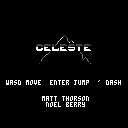

# Celeste Classic — Macintosh Classic port

A port of **Celeste Classic** to the original black-and-white Macintosh — a
7.8 MHz 68000 running System 6, no FPU, no color QuickDraw, 1-bit screen. Built
with the [Retro68](https://github.com/autc04/Retro68) cross-compiler; runs on a
real Mac Plus/SE/Classic (or in Mini vMac / Basilisk II).

Part of [Classic Mac Games](https://www.mitchellv.me/work/classic-mac) · by [Mitchell Vizensky](https://www.mitchellv.me), game UX designer



## What this is

The game logic is a C port of the original PICO-8 game. This repo is the work
of wrapping that logic in a Classic Mac application and making it playable on a
68000:

- **`src/mac_*.c`** — the Mac Toolbox layer: window, event loop, fixed-timestep
  loop with decoupled render, Sound Manager audio, preferences.
- **`src/p8.c`** — a from-scratch PICO-8 drawing API (128×128 palette-index
  framebuffer, sprites, map, text) with no floating point.
- **`src/mac_display.c`** — 4bpp index → 1-bit dithering and a dirty-rectangle
  blit path tuned for the 68000 (see `PORTING-NOTES.md`).
- **`src/celeste_glue.c`** — bridges the game's PICO-8 calls to `p8.c`, with a
  room-cache so the static level isn't re-tiled every frame.
- Fixed-point math (16.16) stands in for the missing FPU.

`PORTING-NOTES.md` documents the performance work in detail.

## Credits & licensing

- **Celeste Classic** is by **Maddy Thorson & Noel Berry**, released free in
  2015 as a PICO-8 game. All game design, art, music, and level data originate
  with them and remain their work. <https://www.lexaloffle.com/bbs/?tid=2145>
- **`src/celeste.c`** is derived from **[ccleste](https://github.com/lemon32767/ccleste)**
  by lemon32767 — a line-by-line C translation of the original Lua source. The
  converted game data in `src/generated/` comes from the freely-distributed
  Celeste Classic cartridge.
- The **Macintosh port layer** (everything under `src/mac_*`, `p8.c`,
  `celeste_glue.c`, the dithering/display path, and the build) is original work
  in this repo.

This is a non-commercial hobby port shared in the spirit of the original's free
release. If you are one of the original authors and would like anything changed
or removed, please open an issue.

## Building

Requires the [Retro68](https://github.com/autc04/Retro68) toolchain installed at
`~/Retro68-build`.

```bash
./build.sh          # produces Celeste.dsk
```

Boot a System 6/7 disk in Mini vMac, then drag `Celeste.dsk` onto it to run.

## Controls

WASD / arrows to move · Enter to jump · `'` to dash.
